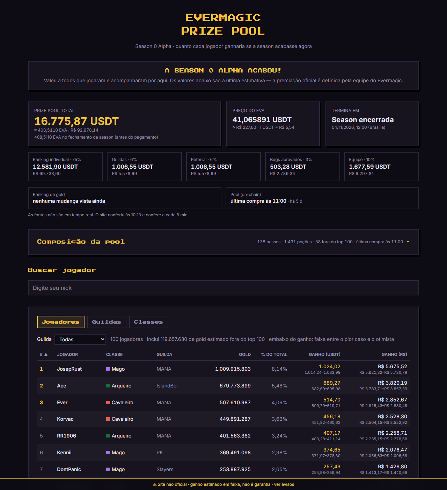

# Evermagic Prize Pool · calculadora não oficial

Calculadora da prize pool da **Season 0 Alpha** do [Evermagic](https://evermagic.io): mostra quanto cada
jogador levaria da premiação se a season acabasse naquele momento.

**Site no ar: [calculadora-evermagic.vercel.app](https://calculadora-evermagic.vercel.app)**



## O que é

A Season 0 Alpha teve uma prize pool paga em EVA, na Arbitrum. 75% dela vai para o ranking individual,
dividido pelo gold de cada jogador; o resto vai para guildas (6%), referral (6%), bugs aprovados (3%) e
equipe (10%).

A calculadora junta o ranking oficial do jogo, o saldo da carteira da pool na blockchain e o preço do EVA,
e transforma isso em um valor por jogador, em USDT e em reais.

## Popularidade

O site virou o ponto de referência da comunidade durante a Season 0 Alpha. Os jogadores usavam a
calculadora para conferir quanto iam ganhar, acompanhar a disputa do ranking de gold e comparar guildas e
classes. Ele foi ganhando funcionalidades ao longo da season: composição da pool on-chain, faixa de ganho,
aba de classes e horário de atualização de cada fonte.

## Funcionalidades

- **Prize pool ao vivo** em USDT, EVA e R$, com a divisão entre as fatias.
- **Ranking de jogadores** com o ganho estimado de cada um, numa faixa entre pior caso e otimista.
- **Busca por nick** para achar o próprio ganho direto.
- **Guildas**: quanto cada guilda leva dos 6%, dividido pelo GP ou pelo gold dos membros no top 100.
- **Classes**: ganho, nível médio e número de jogadores de Cavaleiro, Arqueiro e Mago.
- **Composição da pool**: quantos passes e poções entraram na carteira, lidos na blockchain, com
  gráfico por dia.
- **Simulador**: ajuste quanto gold existe fora do top 100 e veja o efeito no valor por gold.
- **Transparência**: o topo mostra quando cada fonte mudou de fato, não só quando o site conferiu.

## Status

A Season 0 Alpha terminou em 04/11/2026, às 12:00 (Brasília), e a premiação foi paga em 06/11. Desde
então o site mostra a pool travada no saldo do fechamento (408,511 EVA); só o preço do EVA continua ao
vivo. A premiação oficial é definida pela equipe do Evermagic.

Se houver uma próxima season, basta atualizar as datas, os preços e o saldo em [config.ts](config.ts)
(`POOL_FINAL = null` volta a ler o saldo ao vivo).

## Stack

Next.js 16 (App Router) · React 19 · TypeScript · Tailwind CSS 4 · [viem](https://viem.sh) para a
leitura on-chain · Vitest. Sem banco de dados: tudo vem das fontes públicas, com cache em memória.

## Rodar local

Requer Node 20.9+ (testado no 24).

```bash
npm install
npm run dev        # http://localhost:3000
npm test           # testes unitários (Vitest)
npm run build      # build de produção (também checa tipos)
```

Para ver os dados crus que o site usa:

```bash
curl http://localhost:3000/api/pool
curl http://localhost:3000/api/ranking
curl http://localhost:3000/api/composition
```

## Deploy na Vercel

1. Faça um fork do repositório.
2. Em vercel.com → **Add New → Project** → importe o fork. A Vercel detecta Next.js sozinha; não precisa mudar nada no build.
3. (Opcional) Em **Settings → Environment Variables**, defina `ARBITRUM_RPC_URL` com um RPC próprio (Alchemy, Infura etc.) se o público `https://arb1.arbitrum.io/rpc` começar a limitar.
4. Deploy. Ou, pela CLI: `npx vercel` (preview) e `npx vercel --prod`.

## De onde vem cada dado

O Evermagic não tem API pública oficial. O site usa os mesmos endpoints que as páginas oficiais usam, mais a
blockchain.

| Dado | Fonte | Observação |
| --- | --- | --- |
| Ranking de gold (top 100) | `GET na-bridge.evermagic.io/bridge/ranking/gold` | Mesmo endpoint da página oficial de leaderboard. Não exige `Origin`/`Referer`; tem rate limit (20 req/janela). |
| Ranking de guildas | `GET na-bridge.evermagic.io/bridge/ranking/guild` | Traz nível, GP e total de membros de cada guilda. |
| Ranking de nível (top 100) | `GET na-bridge.evermagic.io/bridge/ranking/level` | Única fonte da classe (`knight`, `archer`, `mage`). Vem junto em `/api/ranking`, com o mesmo cache. Às vezes trava para o servidor da Vercel (timeout de 4 s); aí a página busca direto na fonte (CORS liberado). |
| Saldo da pool | Arbitrum One, `balanceOf` de EVA e USDT na carteira [`0x1390…21A1`](https://arbiscan.io/address/0x139061180aDea785DD8A1a32e4A2B1188d2621A1) | Lido ao vivo via viem (multicall). Depois do fim da season fica travado no saldo do fechamento (`POOL_FINAL` em `config.ts`: 408,511 EVA no bloco 521.206.599). |
| Composição da pool | Arbitrum One, eventos `Transfer` do EVA para a carteira da pool (e saindo dela) | `/api/composition`. Lidos em janelas de 9.000.000 blocos (o RPC público aceita até 10.000.000 por `eth_getLogs`), no máximo 5 chamadas ao mesmo tempo. Cada entrada é classificada em aporte, passes e poções. |
| Preço do EVA | `GET na-bridge.evermagic.io/bridge/eva/price?amount=1` | Mesma fonte da página evermagic.io/prizepool. |
| USDT → BRL | `api.coinbase.com/v2/exchange-rates?currency=USDT` | Opcional: se falhar, os valores em R$ aparecem como "—". A AwesomeAPI não é usada porque responde HTTP 429 para os IPs da Vercel. |

Endereços, URLs, percentuais da divisão, data de fim da season, preços do passe e da poção, aporte inicial e
fator do cenário provável ficam em [config.ts](config.ts).

### Cache e falhas

- As rotas `/api/ranking` e `/api/pool` buscam as fontes **pelo servidor**, guardam o resultado em memória por 5 minutos e respondem com `Cache-Control: s-maxage=300`, então a CDN da Vercel segura o tráfego e as fontes não são chamadas a cada visita.
- Se uma fonte falhar, o servidor devolve o último dado bom e o site mostra "dados de HH:MM".
- Depois de uma falha, a fonte só é tentada de novo após 1 minuto (não a cada visita).
- O navegador atualiza a cada 5 minutos.
- Requisições saem com o User-Agent `evermagic-pool-calc/1.0` (ajuste em `config.ts`).
- `/api/composition` tem cache de 10 minutos e leitura incremental: a 1ª chamada da instância lê todas as
  transferências desde o bloco 491.000.000 (~3 s); as seguintes leem só os blocos novos (mais ~2.000 blocos
  relidos por segurança, sem duplicar). Se entradas − saídas não fechar com o saldo, a próxima leitura é completa.
- A página não espera por `/api/composition`: carrega sem a faixa e ela aparece quando a composição chega.
  Se a composição falhar, os ganhos ficam sem faixa (só o top 100).

### Quando cada fonte mudou

As fontes não são em tempo real, então o topo da página mostra quando cada uma mudou de verdade:

- **Pool (on-chain)**: horário do bloco da última compra.
- **Ranking de gold**: a API não informa data. O cache (`cached` em `lib/http.ts`) compara cada leitura
  com a anterior e guarda `sameSince` (1ª leitura com o conteúdo atual) e `changedAfter` (última leitura
  com o conteúdo antigo). Como fica em memória, depois que a instância reinicia o site mostra "nenhuma
  mudança vista ainda" até ver a próxima mudança.

## Cálculo

```
poolTotalUSDT  = saldoEVA × precoEVA + saldoUSDT
poolIndividual = poolTotalUSDT × 0,75
goldTotal      = soma do gold do top 100 + gold fora do top (slider; padrão = estimativa on-chain provável)
valorPorGold   = poolIndividual / goldTotal
ganhoJogador   = gold do jogador × valorPorGold
```

### Composição e faixa de ganho

O ranking público mostra só o top 100, mas jogadores fora dele também dividem a pool. Para estimar quantos
são, o site conta os passes vendidos na blockchain.

Cada transferência de compra é `valor = 0,682·passes + 0,045·poções` (em wei, sem ponto flutuante), testando
de 0 a 20 passes. O aporte é a transferência de 250 EVA da carteira da equipe. Valor que não fecha em
nenhuma combinação aparece como "não identificada" no painel, assim como qualquer saída da carteira.

```
pagantesForaTop = max(0, passes vendidos − jogadores no ranking (100))   // supõe que todo o top 100 tem passe
gold100         = gold do 100º colocado
otimista        = poolIndividual / goldTop100
provável        = poolIndividual / (goldTop100 + pagantesForaTop × gold100 × 0,5)
pior caso       = poolIndividual / (goldTop100 + pagantesForaTop × gold100)
```

O valor em destaque é o provável; embaixo aparece a faixa entre o pior caso e o otimista. O slider do
simulador começa na estimativa provável e pode ser ajustado à mão ("Voltar para a estimativa" desfaz).

- **Guildas (suposição)**: a regra oficial não diz como os 6% são divididos. O padrão é proporcional ao GP (pontos de guilda), que é o que ordena o ranking oficial de guildas; a aba Guildas também permite dividir pelo gold dos membros no top 100.
- **Referral e bugs**: só o total de cada fatia (não há dados por jogador).
- **Classes**: `joinLevels` cruza o ranking de gold com o de nível pelo nick (sem diferenciar maiúsculas, com trim). Quem está no top de gold e fora do top 100 de nível fica como "classe desconhecida". `classStats` usa o mesmo cálculo da aba Jogadores, então as classes somadas fecham com o total do ranking individual. Os dados cobrem só o topo, não o servidor inteiro.

## Estrutura

```
config.ts            URLs, endereços, percentuais, data de fim
lib/calc.ts          cálculos puros (testados em lib/calc.test.ts)
lib/composition.ts   classificação das transferências, paginação e leitura incremental (puro)
lib/evermagic.ts     fetch e normalização dos endpoints do na-bridge
lib/chain.ts         leitura on-chain (viem): saldos e transferências
lib/http.ts          fetch com User-Agent + cache em memória com fallback
lib/format.ts        números no formato brasileiro
app/api/*/route.ts   rotas do servidor
app/page.tsx         página (cliente)
app/components.tsx   seções da página
```

## Contribuir

Issues e pull requests são bem-vindos: bug no cálculo, fonte que mudou, ideia de funcionalidade. Antes de
abrir um PR, rode `npm test` e `npm run build`.

## Avisos

Site não oficial, sem vínculo com a Ever Magic. O ranking público mostra só o top 100 de gold; a faixa de
ganho é estimada pelos passes vendidos on-chain, supondo que todo o top 100 tem passe e que ninguém de fora
passa o 100º colocado. Compras feitas por fora da carteira da pool e jogadores no modo demo não entram na
conta. Não é garantia de prêmio nem recomendação de investimento.

## Licença

[MIT](LICENSE)
